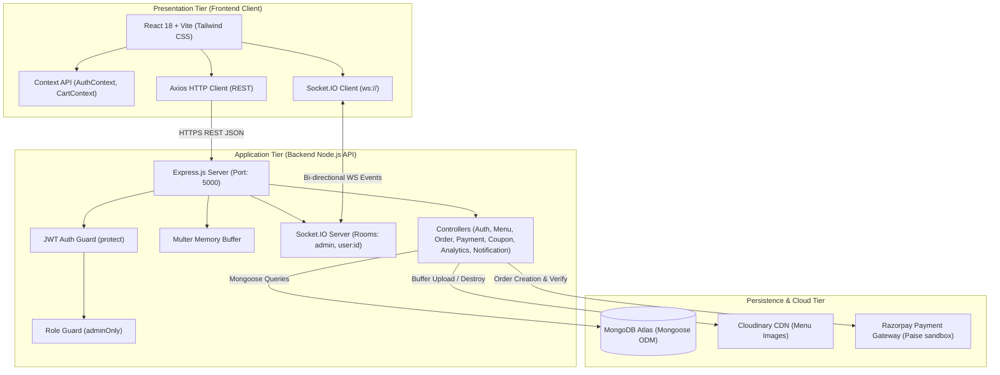
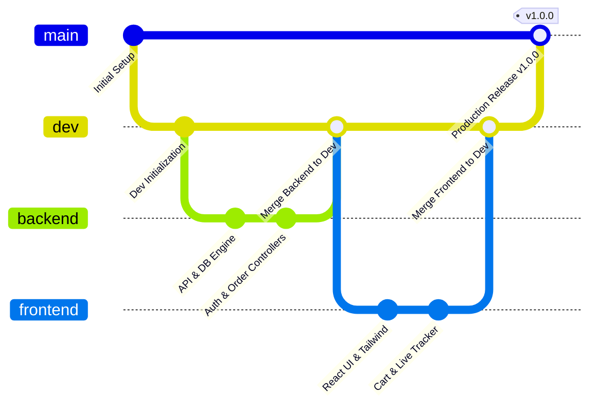
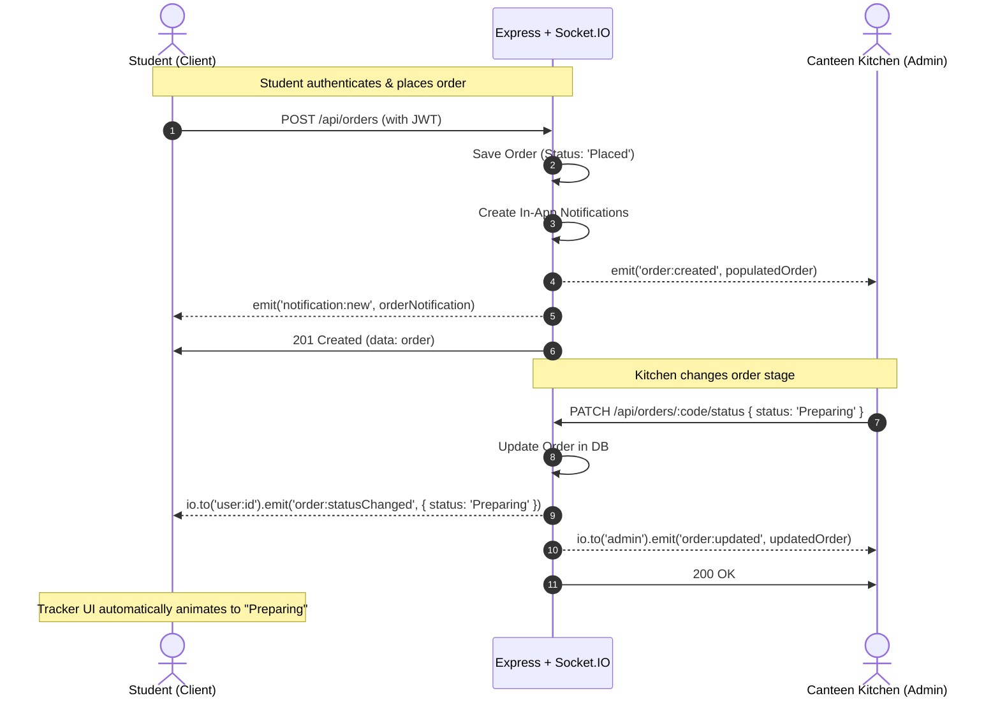
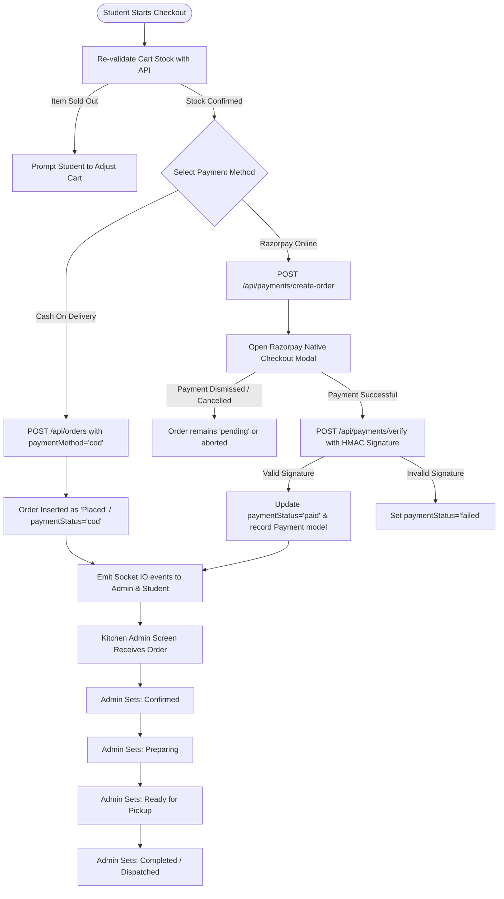

# System Architecture & Technical Specifications
## DRS Quick Serve — Smart Canteen Management System

**GitHub Repository**: [https://github.com/sakthi-velr/Smart-Canteen-Management.git](https://github.com/sakthi-velr/Smart-Canteen-Management.git)  
**Version**: `1.0.0`  
**Architecture Style**: Monorepo Client-Server (REST API + Real-Time WebSocket Event Bus)

---

## 📑 Table of Contents
1. [System Overview & Objectives](#1-system-overview--objectives)
2. [High-Level Architecture](#2-high-level-architecture)
3. [Git Branching & Repository Strategy](#3-git-branching--repository-strategy)
4. [Frontend Architecture](#4-frontend-architecture)
5. [Backend Architecture & Middleware](#5-backend-architecture--middleware)
6. [Real-Time WebSocket Engine (Socket.IO)](#6-real-time-websocket-engine-socketio)
7. [Database Architecture & Data Models](#7-database-architecture--data-models)
8. [End-to-End Order & Payment Workflow](#8-end-to-end-order--payment-workflow)
9. [Security, Authentication & Authorization](#9-security-authentication--authorization)
10. [Comprehensive API Endpoints Matrix](#10-comprehensive-api-endpoints-matrix)
11. [Deployment, Testing & Environment Configuration](#11-deployment-testing--environment-configuration)

---

## 1. System Overview & Objectives

**DRS Quick Serve** is an automated Smart Canteen Management platform designed to digitize dining experiences in educational institutions and enterprise cafeterias. The primary goals are:
- **Zero Queue Overhead**: Allowing students and staff to browse, customize, order, and pay ahead of time from anywhere on campus.
- **Kitchen Flow Optimization**: Providing kitchen managers with live order queue boards, audible notifications, instant status updates, and automated inventory controls.
- **Transparent Order Tracking**: Real-time multi-stage visual stepper (Placed ➔ Confirmed ➔ Preparing ➔ Ready ➔ Completed) updating automatically without page reloads.
- **Actionable Business Intelligence**: Comprehensive analytics for canteen management including sales trends, popular dish matrices, and payment breakdowns.

---

## 2. High-Level Architecture

The platform is designed following a decoupled, layered micro-service ready architecture comprising the **Presentation Tier (React Client)**, the **Application & Integration Tier (Node/Express Server)**, and the **Data & Media Persistence Tier (MongoDB Atlas + Cloudinary + Razorpay)**.



---

## 3. Git Branching & Repository Strategy

To maintain clean code governance, separation of concerns, and stable releases, the project adheres to a 4-tier branching model:



### Branch Hierarchy & Responsibilities:

| Branch Name | Origin / Base | Purpose & Responsibility | Access / Rules |
| :--- | :--- | :--- | :--- |
| `main` | Root | **Production Branch**: Holds stable, production-tested, deployable code. Never commit directly to `main`. | Protected. Releases tagged here. |
| `dev` | `main` | **Integration Branch**: Aggregates verified features from `frontend` and `backend`. Automated regression testing runs here. | Primary merge target for feature branches. |
| `frontend` | `dev` | **Frontend Development**: React client, Tailwind styling, UI components, state management, and client routing. | Feature work for user interface & UX. |
| `backend` | `dev` | **Backend Development**: Express REST routes, Mongoose schemas, controllers, socket listeners, and test suites. | Feature work for APIs, database, and integrations. |

---

## 4. Frontend Architecture

The frontend is built using **React 18** packaged with **Vite** for sub-second hot-module reloading and optimized production bundles.

```
frontend/src/
├── admin/                    # Admin Portal Pages
│   ├── Categories.jsx        # Category creation & active filters
│   ├── Coupons.jsx           # Promotional discount management
│   ├── Dashboard.jsx         # Analytics charts (Recharts) & KPIs
│   ├── LiveTracking.jsx      # Real-time Kitchen Order Queue & Sound Alerts
│   ├── MenuManagement.jsx    # Item CRUD, image upload modal, availability switch
│   └── Payments.jsx          # Digital payment audit log viewer
├── components/
│   ├── common/               # ProtectedRoute & RoleGuard components
│   ├── layout/               # Header, Footer, AdminLayout, Navigation
│   ├── notifications/        # NotificationBell, NotificationItem dropdown
│   └── tracker/              # OrderStatusStepper (Vertical progressive tracker)
├── context/
│   ├── AuthContext.jsx       # Global user token, login, logout, profile update
│   └── CartContext.jsx       # LocalStorage cart persistence, coupon engine
├── pages/                    # Student Portal Pages
│   ├── Bill.jsx              # Print-friendly tax invoice receipt
│   ├── Cart.jsx              # Cart items, Razorpay checkout, COD options
│   ├── Home.jsx              # Hero banner, featured dishes carousel
│   ├── Login.jsx             # Authentication gateway with role redirection
│   ├── Menu.jsx              # Searchable, categorised food grid with filters
│   ├── Orders.jsx            # Student past & active order history
│   ├── Profile.jsx           # Account details & password change
│   ├── Register.jsx          # Student registration with validation
│   └── Tracker.jsx           # Live Socket order tracker by orderCode
└── services/
    ├── api.js                # Axios instance with auto JWT Bearer token injector
    └── notificationService.js# Notifications API wrapper
```

### Key Frontend Mechanisms:
1. **Axios Centralized Interceptor**:
   Automatically retrieves the JWT token from `localStorage('drs_user')` and attaches `Authorization: Bearer <token>` to all outbound requests.
2. **Cart State Machine (`CartContext`)**:
   - Persists cart items to browser `localStorage('drs_cart')`.
   - Re-evaluates coupon eligibility and recalculates discounts on item additions, deletions, or quantity modifications.
   - Pre-checkout stock re-verification calling `GET /api/menu` to ensure items did not sell out while sitting in cart.
3. **Audio-Visual Real-Time Alerts**:
   - Built-in Web Audio API sound chime triggers when new orders arrive on the admin kitchen screen (`order:created`) or when student order status transitions (`order:statusChanged`).

---

## 5. Backend Architecture & Middleware

The backend runs on **Node.js** with **Express.js**, following an organized MVC (Model-View-Controller, where View is replaced by the JSON REST response layer).

```
backend/
├── config/
│   ├── cloudinary.js         # Cloudinary SDK credentials & storage helpers
│   ├── db.js                 # Mongoose connection pool
│   └── razorpay.js           # Razorpay instance with key/secret pair
├── controllers/              # Business logic controllers
│   ├── analyticsController.js
│   ├── authController.js
│   ├── categoryController.js
│   ├── couponController.js
│   ├── menuController.js
│   ├── notificationController.js
│   ├── orderController.js
│   └── paymentController.js
├── middleware/
│   ├── adminMiddleware.js    # Enforces req.user.role === 'admin'
│   ├── authMiddleware.js     # Validates JWT signature & attaches req.user
│   ├── errorMiddleware.js    # notFound 404 catcher & central error serializer
│   └── uploadMiddleware.js   # Multer memory storage (buffer handling)
├── models/                   # Mongoose Schemas & Data Constraints
│   ├── Category.js
│   ├── Coupon.js
│   ├── MenuItem.js
│   ├── Notification.js
│   ├── Order.js
│   ├── Payment.js
│   └── User.js
├── routes/                   # Endpoint routers mapped to Express app
├── scripts/
│   ├── migrateImages.js      # Seed Cloudinary remote asset migration
│   ├── seed.js               # Database population script (Users, Menu, Categories)
│   └── testAllApis.js        # Automated 43-point end-to-end test suite
├── sockets/
│   └── orderSocket.js        # Socket.IO connection handlers & room management
├── utils/
│   ├── generateOrderCode.js  # Collision-free DRS-XXXX random sequence generator
│   ├── generateToken.js      # JWT token sign utility (30-day expiry)
│   └── notificationHelper.js # Centralized DB notification save & WS broadcast
└── server.js                 # Server entry point, HTTP & Socket.IO listener
```

---

## 6. Real-Time WebSocket Engine (Socket.IO)

Real-time communication enables seamless synchronization between the student tracking their order and the kitchen staff preparing it.



### Socket Event Dictionary:

| Event Name | Direction | Payload | Description |
| :--- | :--- | :--- | :--- |
| `order:created` | Server ➔ Admin | `Order` object | Triggered upon successful order creation. Prompts audio chime on kitchen board. |
| `order:statusChanged` | Server ➔ User room | `{ orderId, orderCode, status, paymentStatus }` | Direct notification to the ordering student's tracking screen. |
| `order:updated` | Server ➔ Admin room | `Order` object | Broadcast to all open admin tabs to refresh lists in place. |
| `menu:availabilityChanged`| Server ➔ All | `{ id, available }` | Instantly locks/unlocks add-to-cart button on all customer devices. |
| `menu:updated` | Server ➔ All | `MenuItem` object | Broadcast when admin changes prices, descriptions, or images. |
| `notification:new` | Server ➔ User room | `Notification` object | Displays toast and updates the unread badge in Header. |

---

## 7. Database Architecture & Data Models

### Entity Relationship Diagram

```mermaid
erDiagram
    USER ||--o{ ORDER : places
    USER ||--o{ NOTIFICATION : receives
    CATEGORY ||--o{ MENU_ITEM : categorizes
    ORDER ||--|{ ORDER_ITEM : contains
    ORDER ||--o| PAYMENT : records
    COUPON ||--o{ ORDER : applies_discount_to

    USER {
        ObjectId _id PK
        string name
        string email UK
        string password
        string role "user | admin"
        string phone
        date createdAt
    }

    CATEGORY {
        ObjectId _id PK
        string name UK
        boolean active
        date createdAt
    }

    MENU_ITEM {
        ObjectId _id PK
        string name
        ObjectId category FK
        number price
        string emoji
        object image "url, publicId"
        boolean available
        boolean featured
        number preparationTime
    }

    ORDER {
        ObjectId _id PK
        string orderCode UK "DRS-XXXX"
        ObjectId user FK
        array items "menuItem, name, price, qty"
        number subtotal
        number discount
        number total
        string coupon
        string paymentMethod "cod | razorpay"
        string paymentStatus "pending | paid | failed | cod"
        string status "Placed|Confirmed|Preparing|Ready|Completed|Cancelled"
        date createdAt
    }

    COUPON {
        ObjectId _id PK
        string code UK
        string discountType "flat | percentage"
        number discountValue
        number minimumOrder
        number maxDiscount
        date expiryDate
        number usageLimit
        number usedCount
        boolean active
    }

    PAYMENT {
        ObjectId _id PK
        ObjectId order FK
        string razorpayOrderId
        string razorpayPaymentId
        string razorpaySignature
        number amount
        string status "captured | failed"
        date createdAt
    }

    NOTIFICATION {
        ObjectId _id PK
        ObjectId user FK
        string title
        string message
        string type "ORDER_STATUS | SYSTEM"
        boolean read
        ObjectId order FK
        date createdAt
    }
```



---

## 8. End-to-End Order & Payment Workflow



---

## 9. Security, Authentication & Authorization

1. **Password Security**:
   - Passwords hashed using `bcryptjs` with auto-generated salt rounds (factor 10) before MongoDB persistence.
2. **Stateless JWT Authorization**:
   - Access tokens signed with HMAC-SHA256 containing user ID and expiration window (30 days).
   - Middleware `protect` extracts and verifies Bearer token, populating `req.user` without password hash.
3. **Role-Based Access Control (RBAC)**:
   - `adminOnly` middleware intercepts requests to administration endpoints (`/api/categories`, `/api/menu`, `/api/orders/active`, `/api/analytics/*`, `/api/payments/admin/list`).
   - Non-admin users are halted with HTTP 403 Forbidden.
4. **Input Defense & Query Injection Prevention**:
   - Regular expression user inputs (e.g. search terms) are sanitized using `replace(/[.*+?^${}()|[\]\\]/g, '\\$&')`.
   - Parameter IDs are pre-checked with `mongoose.Types.ObjectId.isValid()` to eliminate unhandled `CastError` 500 exceptions.
5. **HMAC SHA256 Signature Verification**:
   - Online payments are validated against Razorpay's HMAC SHA256 algorithm: `crypto.createHmac('sha256', secret).update(order_id + '|' + payment_id).digest('hex')`.

---

## 10. Comprehensive API Endpoints Matrix

All **43 endpoints** have been verified and automated in the test suite:

### 1. Authentication (`/api/auth`)
| Method | Endpoint | Access | Description |
| :--- | :--- | :--- | :--- |
| `POST` | `/api/auth/register` | Public | Register student user account |
| `POST` | `/api/auth/login` | Public | Authenticate user/admin & generate JWT token |
| `GET` | `/api/auth/me` | Private | Retrieve authenticated profile details |
| `PUT` | `/api/auth/profile` | Private | Update user display name, phone, or email |
| `PUT` | `/api/auth/change-password` | Private | Change user password with current password confirmation |

### 2. Categories (`/api/categories`)
| Method | Endpoint | Access | Description |
| :--- | :--- | :--- | :--- |
| `GET` | `/api/categories` | Public | Retrieve active menu categories (sorted alphabetically) |
| `POST` | `/api/categories` | Admin | Create a new food category |
| `PUT` | `/api/categories/:id` | Admin | Modify category name or active status |
| `DELETE` | `/api/categories/:id` | Admin | Delete a food category |

### 3. Menu (`/api/menu`)
| Method | Endpoint | Access | Description |
| :--- | :--- | :--- | :--- |
| `GET` | `/api/menu` | Public | Retrieve all menu items (with category, search, and availability filters) |
| `GET` | `/api/menu/:id` | Public | Get single menu item details |
| `POST` | `/api/menu` | Admin | Create menu item (supports `multipart/form-data` image upload) |
| `PUT` | `/api/menu/:id` | Admin | Update menu item details or replace image |
| `PATCH` | `/api/menu/:id/availability` | Admin | Instant real-time toggle between Available and Sold Out |
| `DELETE` | `/api/menu/:id` | Admin | Remove menu item and its Cloudinary media asset |
| `POST` | `/api/menu/:id/image` | Admin | Dedicated image upload or replacement |
| `DELETE` | `/api/menu/:id/image` | Admin | Remove custom image from item |

### 4. Coupons (`/api/coupons`)
| Method | Endpoint | Access | Description |
| :--- | :--- | :--- | :--- |
| `POST` | `/api/coupons/validate` | Public | Verify coupon code, check expiry & minimum spend, calculate discount |
| `GET` | `/api/coupons` | Admin | List all active and past coupon codes |
| `POST` | `/api/coupons` | Admin | Create promotional coupon (Flat or Percentage discount) |
| `PUT` | `/api/coupons/:id` | Admin | Update coupon properties or expiry dates |
| `DELETE` | `/api/coupons/:id` | Admin | Delete a coupon code |

### 5. Orders (`/api/orders`)
| Method | Endpoint | Access | Description |
| :--- | :--- | :--- | :--- |
| `POST` | `/api/orders` | Private | Place new order with verified stock items & optional coupon |
| `GET` | `/api/orders/my` | Private | Get authenticated user's order history |
| `GET` | `/api/orders/:id` | Private | Retrieve order details by `orderCode` (e.g. `DRS-5268`) or Mongo `_id` |
| `GET` | `/api/orders/active` | Admin | Kitchen queue: fetch orders in Placed, Confirmed, Preparing, or Ready states |
| `GET` | `/api/orders` | Admin | Admin complete order log with pagination & filters |
| `PATCH` | `/api/orders/:id/status` | Admin | Progress order status (Placed ➔ Confirmed ➔ Preparing ➔ Ready ➔ Completed) |
| `PATCH` | `/api/orders/:id/cancel` | Private | Cancel order (allowed during Placed / Confirmed stages) |

### 6. Payments (`/api/payments`)
| Method | Endpoint | Access | Description |
| :--- | :--- | :--- | :--- |
| `POST` | `/api/payments/create-order` | Private | Generate Razorpay order ID (with dev mode sandbox fallback) |
| `POST` | `/api/payments/verify` | Private | Verify Razorpay HMAC signature & transition order to `paid` |
| `GET` | `/api/payments/admin/list` | Admin | Admin audit of digital payment transactions |

### 7. Analytics (`/api/analytics`)
| Method | Endpoint | Access | Description |
| :--- | :--- | :--- | :--- |
| `GET` | `/api/analytics/overview` | Admin | Total revenue, total orders count, and status breakdown mapping |
| `GET` | `/api/analytics/revenue` | Admin | 7-day chronological revenue trends for bar/area charts |
| `GET` | `/api/analytics/popular-items` | Admin | Top 5 best selling dishes grouped by order frequency and gross revenue |
| `GET` | `/api/analytics/payments` | Admin | Distribution of Cash Counter vs Razorpay Online orders |
| `GET` | `/api/analytics/payment-methods`| Admin | Compatible alias for payment distribution metrics |

### 8. Notifications (`/api/notifications`)
| Method | Endpoint | Access | Description |
| :--- | :--- | :--- | :--- |
| `GET` | `/api/notifications` | Private | Fetch user's notification history with pagination |
| `GET` | `/api/notifications/unread` | Private | Get integer count of unread notifications |
| `PATCH` | `/api/notifications/:id/read` | Private | Mark single notification as read |
| `PATCH` | `/api/notifications/read-all` | Private | Mark all unread notifications as read |
| `DELETE` | `/api/notifications/:id` | Private | Delete individual notification |

---

## 11. Deployment, Testing & Environment Configuration

### Quick Start Commands:

```bash
# 1. Install all dependencies across root, client, and server
npm run install-all

# 2. Populate database with default menu, categories, and accounts
npm run seed

# 3. Execute the automated 43-point API audit suite
npm run test:apis

# 4. Start concurrent development servers
npm run dev
```

### Port Mappings & Services:
- **Client Application**: `http://localhost:5173`
- **REST API & WebSockets**: `http://localhost:5000`
- **MongoDB Atlas Cluster**: Port `27017` / SSL URI
- **Automated Test Harness**: `http://localhost:5099` (ephemeral port)
